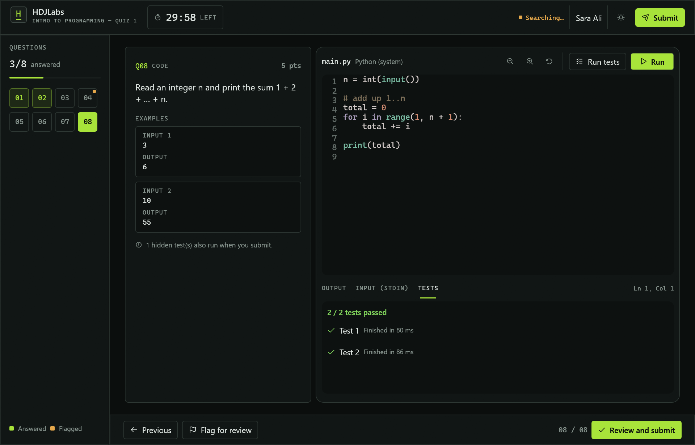
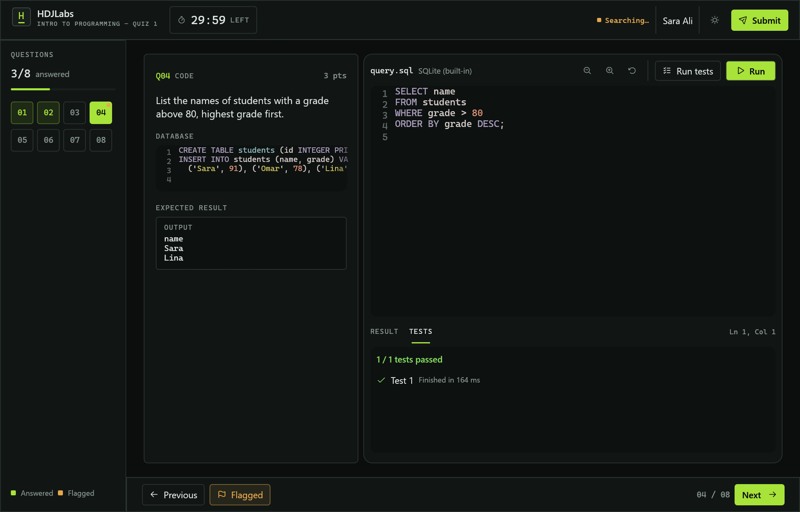
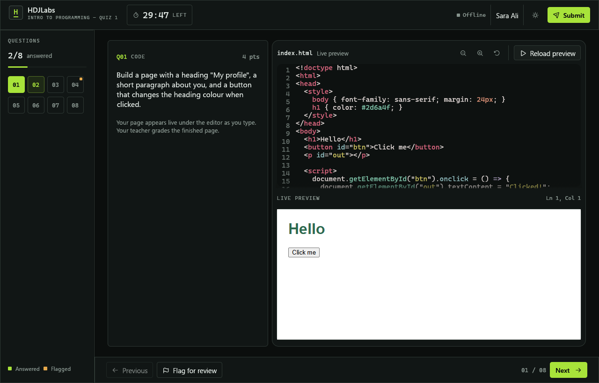
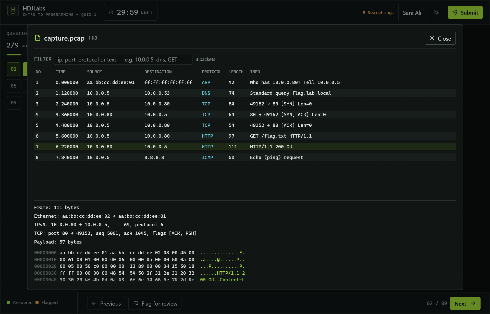
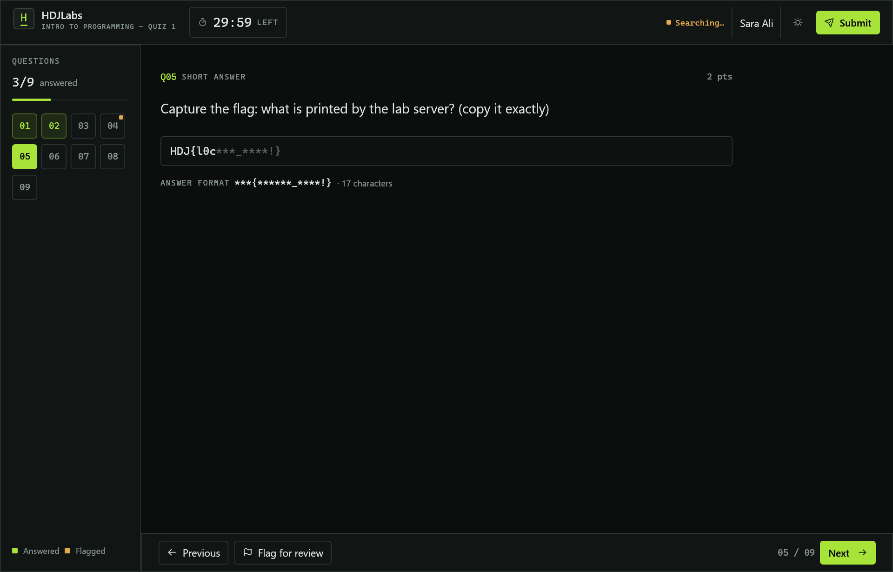
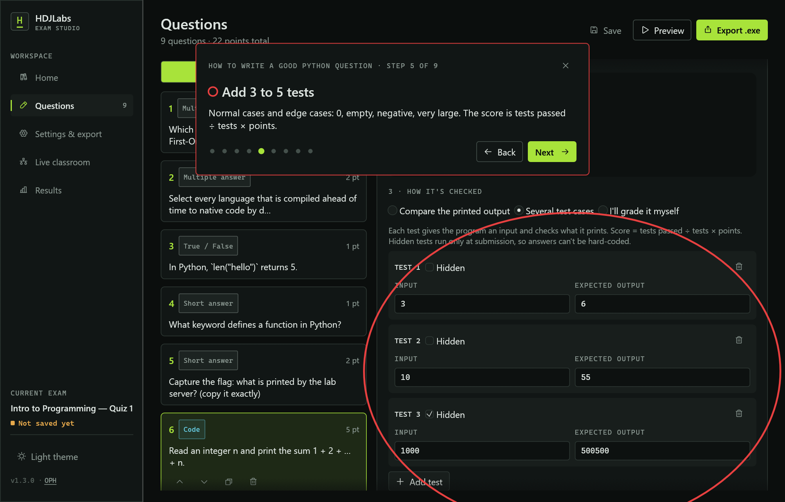
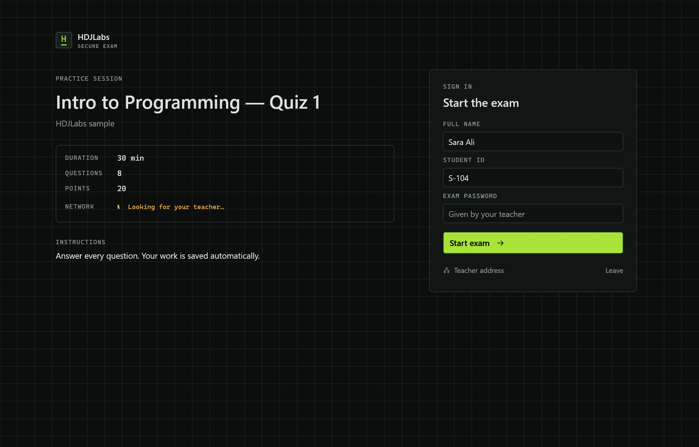
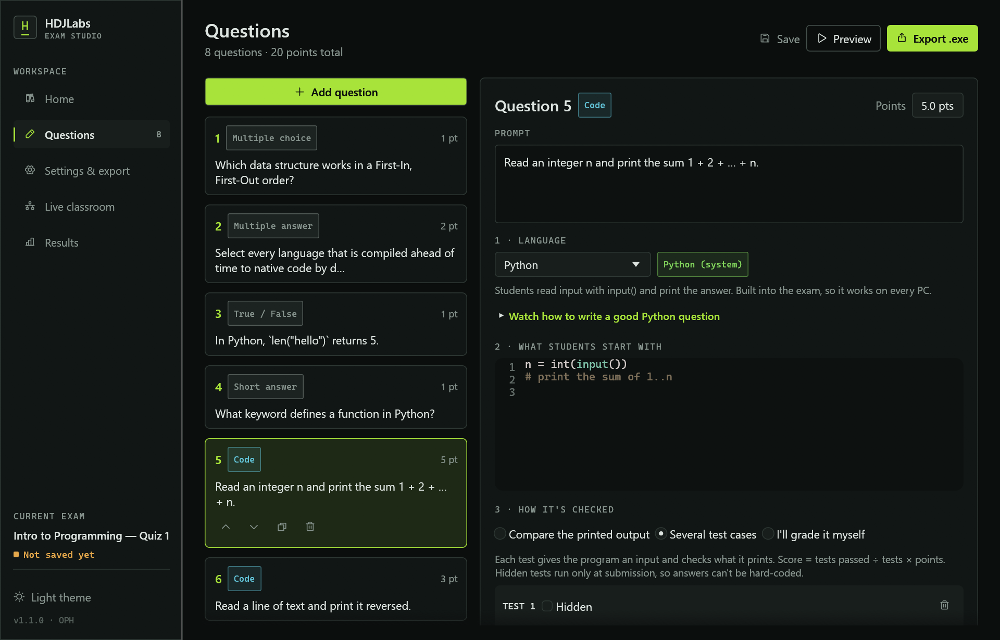
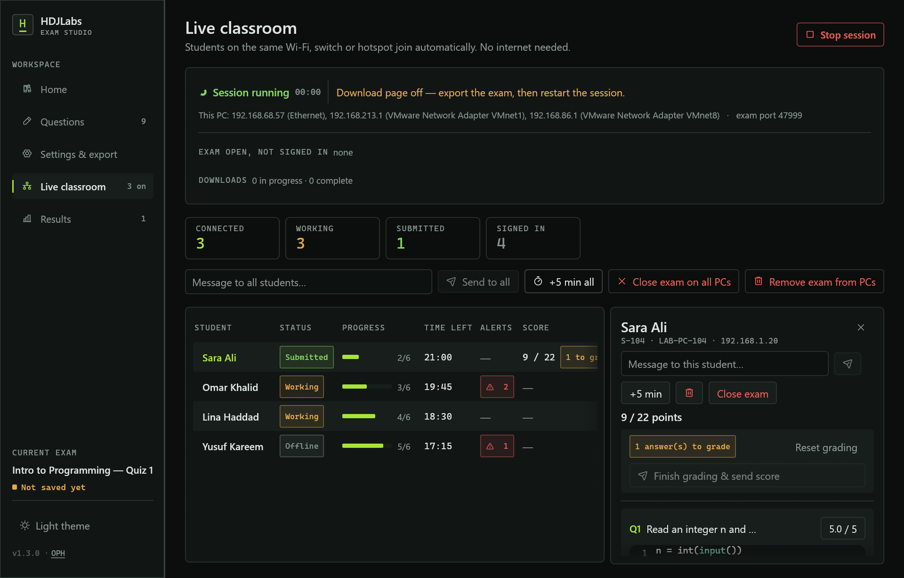
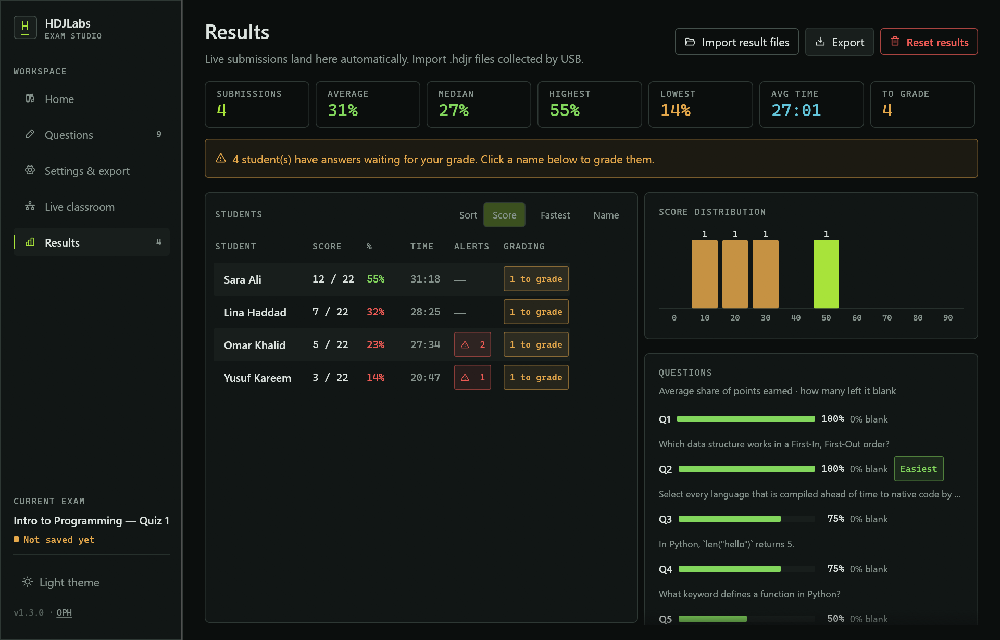

<p align="center">
  
</p>

<h1 align="center">HDJLabs</h1>

<p align="center">
  Build an exam. Ship it as one locked-down Windows <code>.exe</code>. Collect results over the classroom network.
  <br>
  No internet, no accounts, no server. Windows 7 SP1 through 11.
</p>

<p align="center">
  <a href="https://github.com/op-h/HDJLabs/releases/latest/download/HDJLabs-Setup.exe"><b>Download the installer</b></a>
  &nbsp;·&nbsp;
  <a href="https://github.com/op-h/HDJLabs/releases/latest/download/HDJLabs.exe">Portable .exe</a>
  &nbsp;·&nbsp;
  <a href="https://quiz.op-h.tech">Website</a>
  &nbsp;·&nbsp;
  <a href="docs/classroom-network.md">Classroom setup</a>
  &nbsp;·&nbsp;
  <a href="docs/security-review.md">Security review</a>
</p>

<p align="center">
  
</p>

---

## What it does

HDJLabs is one Windows program with two roles.

| Teacher — **HDJLabs Studio** | Student — **the exported exam** |
|---|---|
| Write multiple-choice, multiple-answer, true/false, short-answer and **code** questions, in English or Arabic (typed and shown right-to-left with joined letters). Attach **files** to any question: images, packet captures, logs. | Runs from a single portable `.exe`. Nothing to install. |
| Export the exam as an encrypted `.exe` with an exam password and a proctor exit password. | Locks the PC until submission: other apps, the taskbar, shortcuts and touchpad gestures are blocked. |
| Run a **Live classroom**: students download the exam from your PC; you see every download, every PC that has it open, and everyone who signed in. | A real code editor. **Python, JavaScript, SQL and HTML/CSS/JS are built in**; C, C++, Java, Go and Rust use compilers already on the PC. |
| Watch progress and alerts, read each student's code as they write it, message them, add time, end the exam. | Answers autosave, encrypted, and survive crashes and power cuts. |
| Every submission is re-graded on your PC, so a score can't be faked. **Grade code in the Live classroom** and send the final score to the student's screen. Results show the class analytics; export **Excel, PDF or CSV**. Close the exam on every PC, then **remove the exam file**. | The result goes to the teacher over the LAN and is also saved as a sealed `.hdjr` file for USB collection. |

## Download

| | |
|---|---|
| **[HDJLabs-Setup.exe](https://github.com/op-h/HDJLabs/releases/latest/download/HDJLabs-Setup.exe)** | For teachers. No admin rights needed: per-user by default, or for all users with an admin. Adds Start-menu and desktop shortcuts, opens `.hdjx` projects, and includes an uninstaller. |
| **[HDJLabs.exe](https://github.com/op-h/HDJLabs/releases/latest/download/HDJLabs.exe)** | The same Studio as one portable file. |

Runs on **Windows 7 SP1, 8.1, 10 and 11 (64-bit)**. Nothing else is required: the C runtime is built in, and on PCs with no graphics driver (the "Microsoft Basic Display Adapter") HDJLabs switches to a CPU renderer by itself. If SmartScreen appears, choose **More info → Run anyway**. Exams exported from a signed Studio stay signed, releases are set up for free signing through SignPath Foundation, and one setting stops SmartScreen from checking exams downloaded from your PC in the lab: see **[code signing and SmartScreen](docs/code-signing.md)**. Before exam day, run one exported exam on a lab PC to check the lab's antivirus lets it start (see [preparing the lab](docs/classroom-network.md#prepare-the-lab-pcs)).

Open the Studio, click **Load the sample exam** to see every question type, then **Preview** to try it as a student.

## A session, start to finish

1. **Build.** *Add question*, then pick a type. Code questions take three steps: language, starting code, and how it's checked. *Compare the printed output* is the simplest; *several test cases* adds hidden tests. Write your own solution and press **Run**, and the expected output fills itself in.
2. **Export.** In *Settings & export*, set the exam password (announce it when the exam starts) and a proctor exit password (yours only). Then **Export .exe**.
3. **Share.** Open *Live classroom* and press **Start session**. Windows asks for firewall permission once; the checklist shows when everything is ready. Students open the address shown (for example `http://192.168.1.20:47880`) in any browser and download the exam.
4. **Run.** Students run the exam. It finds your PC by itself, with no IP addresses to type. They enter their name and the password and appear on your roster with progress, time left, alerts and live answers.
5. **Grade and clean up.** Choice, true/false and short answers are graded instantly. Code is graded by running every test case, hidden ones included. Answers that need you (code without tests, HTML pages) show **Needs grading** in *Results*: give *Full marks*, *Half*, *Zero* or exact points, then **Finish grading & send score**. Until then the student's exam shows *Waiting for your teacher to finish grading* instead of a score (turn on *Students wait for me to finish grading* to hold every score). Export CSV, **Reset results** to start over, then **Remove exam from PCs**, or turn on *Delete the exam file from each student's PC after they submit*.

No network? Results are saved as `.hdjr` files in `Documents\HDJLabs Results` and next to the exam file. Import them in *Results*. See **[docs/classroom-network.md](docs/classroom-network.md)** for hotspots, switches and firewall details.

## Question types

| | |
|---|---|
|  | **SQL.** You write the tables and rows; students see them beside the question and write queries. SQLite is built in. |
|  | **HTML / CSS / JavaScript.** Students build a page and watch it render as they type (Edge WebView2 on Windows 10/11). Navigation, pop-ups, printing and devtools are blocked. You grade the page in Results. |
|  | **Files for a question.** Attach images, packet captures (.pcap/.pcapng), logs or code to any question. Students open them inside the exam, even in lockdown: images, text, a Wireshark-style packet list with hex dump, and a hex view for anything else. With lockdown off they can also open or save them. |
|  | **Short answer, TryHackMe style.** Optionally show the answer's shape: letters and digits become `*`, symbols such as `_ { } ! @ #` stay visible, and each character the student types fills one slot (`HDJ{l0c` → `HDJ{l0c***_****!}`). |

| Language | Engine |
|---|---|
| Python | Built in ([RustPython](https://github.com/RustPython/RustPython), standard library included). Uses the PC's CPython if installed. |
| JavaScript | Built in ([Boa](https://github.com/boa-dev/boa)). Uses Node.js if installed, with the same `readline()` / `print()` helpers. |
| SQL | Built in ([SQLite](https://sqlite.org)) |
| HTML / CSS / JS | Built-in live preview |
| C / C++ | gcc / g++ or clang (MinGW, MSYS2, LLVM) |
| Java | JDK (`javac` + `java`) |
| Go / Rust | `go`, `rustc` |

Student code runs in a Windows Job Object: one process maximum (so it can't launch Explorer or a shell from the exam desktop), a memory cap, no clipboard or desktop access, a 6-second limit and capped output. The editor has line numbers that stay put while scrolling, syntax highlighting, Tab/Shift+Tab indentation, auto-indent, Ctrl+/ comments, F5 to run and Ctrl+Enter to run the tests.

## Teacher guides

At the bottom of every question, **How to write a good question** opens a step-by-step guide on the real editor: each slide circles the field it explains in red, scrolls to it, and gives an example for that language. The steps follow the question type and how it's checked (compare the output, several tests, or graded by you).

<p align="center"></p>

## Lockdown

| Layer | What happens |
|---|---|
| Private desktop | The exam runs on its own Win32 desktop, the approach Safe Exam Browser calls *Create New Desktop*. Explorer, the taskbar, Start, notifications and every other window simply don't exist there. |
| Keyboard hook | Win key, Alt+Tab, Alt+Esc, Ctrl+Esc, Alt+F4, Ctrl+Shift+Esc, Print Screen and app-launch keys are swallowed, as are injected keystrokes from macro tools. |
| Ctrl+Alt+Del screen | Task Manager, Lock, Sign out, Change password and the power menu are removed via per-user policy, then restored. |
| Touch & touchpad | Three- and four-finger gestures and touchpad edge swipes are disabled; the window opts out of touch edge swipes. |
| Capture | The window is excluded from screenshots, recording and screen sharing (Windows 10 2004+). |
| Escape hatches | Sticky/Filter/Toggle Keys hotkeys are disabled. The exam never opens a file or print dialog. The clipboard is cleared at start and end. |
| Pre-flight | Refuses to start under Remote Desktop, with remote-control or screen-sharing tools running, or (optionally) inside a VM. |
| Crash safety | Every changed setting is backed up first and restored even after a power cut. Resuming an interrupted attempt is reported to the teacher. |

Proctor access on a student PC: **Ctrl+Shift+F12** or the lock icon opens the proctor password dialog.

## Screenshots

| | |
|---|---|
|  |  |
|  |  |

## Security

Exams are encrypted with Argon2id + ChaCha20-Poly1305 under the exam password, so nobody can read the questions before you announce it, and any edit to the file breaks it. Your Studio re-grades every submission from the answers, so a score reported by a tampered exam doesn't count; tick *Keep the answer key off student PCs* and the exam file carries no correct answers or hidden tests at all. LAN traffic is end-to-end encrypted and only your Studio can decrypt it, so a student can't impersonate the teacher. Result files are sealed to your project's key. The threat model, limits and penetration-test results, including the multi-PC tests on Windows 7 and 8.1, are in **[docs/security-review.md](docs/security-review.md)**.

## Code signing policy

Releases are built from this repository by GitHub Actions and signed through [SignPath Foundation](https://signpath.org) once the project is accepted (free code signing for open source; certificate by SignPath Foundation). Until then, releases are unsigned.

* **Committers and reviewers:** [OPH](https://github.com/op-h)
* **Approver of each signed release:** [OPH](https://github.com/op-h)
* Only builds made by the release workflow from a version tag are signed. Every signed release is listed on the [releases page](https://github.com/op-h/HDJLabs/releases) with SHA-256 checksums.
* **Privacy:** HDJLabs sends nothing to the internet. The Studio and the exams talk only to each other over the classroom network (discovery on UDP 47810, the encrypted exam session on TCP 47811, the download page on TCP 47880). Results stay on the teacher's PC and the students' PCs.

## Build from source

```powershell
# Day-to-day (Windows 10/11 binary)
cargo build --release                 # target\release\HDJLabs.exe
cargo test                            # crypto, packaging, grading, LAN protocol, sandbox

# Release build that also runs on Windows 7 / 8.1 (what the installer ships)
rustup toolchain install nightly-2026-10-30 --component rust-src
$env:CARGO_TARGET_DIR="target-win7"
cargo +nightly-2026-10-30 build --release -Zbuild-std=std,panic_abort --target x86_64-win7-windows-msvc

# Installer (Inno Setup 6)
ISCC.exe installer\HDJLabs.iss        # dist\HDJLabs-Setup.exe
```

```
src/
  main.rs        role dispatch: studio / exam / built-in interpreter
  lockdown.rs    private desktop, keyboard hook, policies, capture exclusion, self-removal
  payload.rs     exam packaging appended to the exe
  crypto.rs      Argon2id, ChaCha20-Poly1305, X25519 sessions and sealed results
  net.rs         discovery, encrypted classroom protocol, download page and progress
  runner.rs      compile + run in a Job Object sandbox
  interp.rs      built-in Python (RustPython), JavaScript (Boa) and SQL (SQLite)
  grading.rs     scoring, test cases
  storage.rs     projects, results, encrypted autosave
  report.rs      Excel and PDF results reports
  sigtag.rs      keeps exported exams validly signed
  ui/            egui interface (OpenGL with CPU fallback): studio, exam, editor, web preview,
                 file viewer (pcap), question guide, right-to-left text
installer/       Inno Setup script
site/            quiz.op-h.tech
```

The original browser-based Quiz Maker is preserved at the [`web-legacy`](https://github.com/op-h/HDJLabs/tree/web-legacy) tag.

## Credits

Built with [egui](https://github.com/emilk/egui), [RustPython](https://github.com/RustPython/RustPython), [Boa](https://github.com/boa-dev/boa), [SQLite](https://sqlite.org), [wry](https://github.com/tauri-apps/wry) and [Phosphor Icons](https://phosphoricons.com) (MIT).

## License

MIT © [OPH](https://github.com/op-h)
