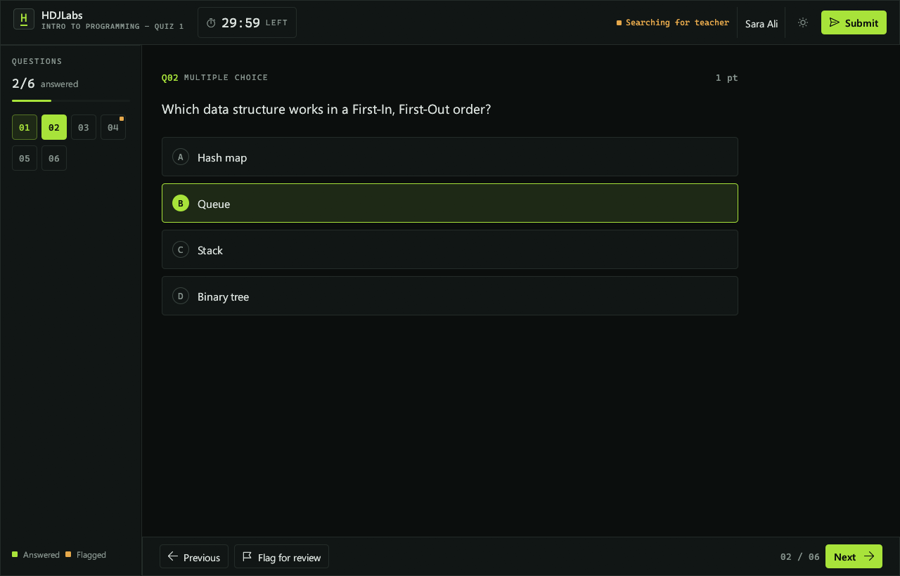
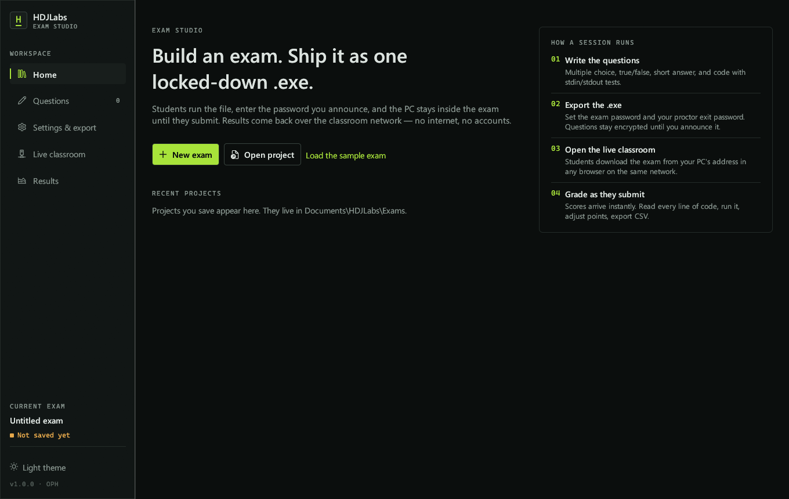

<p align="center">
  
</p>

<h1 align="center">HDJLabs</h1>

<p align="center">
  Build an exam. Ship it as one locked-down Windows <code>.exe</code>. Collect results over the classroom network.
  <br>
  No internet, no accounts, no server to install.
</p>

<p align="center">
  <a href="https://github.com/op-h/HDJLabs/releases/latest/download/HDJLabs.exe"><b>Download HDJLabs.exe</b></a>
  &nbsp;·&nbsp;
  <a href="https://quiz.op-h.tech">Website</a>
  &nbsp;·&nbsp;
  <a href="docs/classroom-network.md">Classroom setup</a>
  &nbsp;·&nbsp;
  <a href="docs/security-review.md">Security review</a>
</p>

<p align="center">
  
</p>

---

## What it does

HDJLabs is one Windows program with two roles.

| Teacher — **HDJLabs Studio** | Student — **the exported exam** |
|---|---|
| Write multiple-choice, multiple-answer, true/false, short-answer and **code** questions. | Runs from a single `.exe`. Nothing to install. |
| Export the exam as an encrypted `.exe` with an exam password and a proctor exit password. | Locks the PC until the exam is submitted. Other apps, the taskbar, shortcuts and touchpad gestures are all blocked. |
| Run a **Live classroom**: students download the exam from your PC and appear on a live roster. | A real code editor with Run, an input box and test results. Python and JavaScript are built in; C, C++, Java, Go and Rust use the compilers already on the PC. |
| Watch progress and alerts, read each student's code as they write it, message them, add time, end the exam. | Answers autosave, encrypted, and survive crashes and power cuts. |
| Scores arrive the moment students submit. Override points, re-run code, export CSV. | The result goes to the teacher over the LAN and is also saved as a sealed `.hdjr` file for USB collection. |

## Download

1. Download **[HDJLabs.exe](https://github.com/op-h/HDJLabs/releases/latest/download/HDJLabs.exe)** (Windows 10 version 2004 or later, Windows 11; 64-bit).
2. Run it. If SmartScreen appears, choose **More info → Run anyway**. The binary isn't code-signed yet.
3. Click **Load the sample exam** to see every question type, then **Preview** to try it as a student.

HDJLabs ships as one portable file. Projects are saved under `Documents\HDJLabs\Exams`.

## A session, start to finish

1. **Build.** Add questions in *Questions*. Code questions take starter code, a private reference solution, and stdin → stdout test cases. *Fill outputs from solution* runs your solution to generate the expected outputs.
2. **Export.** In *Settings & export*, set the exam password (announce it when the exam starts) and a proctor exit password (yours only). Then click **Export .exe**.
3. **Share.** Open *Live classroom*, click **Allow through firewall** once, then **Start session**. Students open the address shown (for example `http://192.168.1.20:47880`) in any browser on the same network and download the exam.
4. **Run.** Students run the exam, enter their name and the password, and appear on your roster with progress, time left, alerts and live answers.
5. **Grade.** Choice, true/false and short answers are graded instantly. Code is graded by running every test case, hidden ones included, on the student's PC at submission. You can re-run it on yours. Adjust any points and export CSV.

No network? Students' results are saved as `.hdjr` files in `Documents\HDJLabs Results` and next to the exam file. Import them in *Results*.

See **[docs/classroom-network.md](docs/classroom-network.md)** for router-less setups (Windows Mobile Hotspot, a plain switch) and firewall details.

## Lockdown

The browser version of this project could only detect a student leaving the exam. A native app can actually prevent it:

| Layer | What happens |
|---|---|
| Private desktop | The exam runs on its own Win32 desktop, the approach Safe Exam Browser calls *Create New Desktop*. Explorer, the taskbar, Start, notifications and every other window simply don't exist there. Touchpad and touchscreen shell gestures have nothing to switch to. |
| Keyboard hook | Win key, Alt+Tab, Alt+Esc, Ctrl+Esc, Alt+F4, Ctrl+Shift+Esc, Print Screen and app-launch keys are swallowed. So are injected keystrokes from macro tools or auto-typers. |
| Ctrl+Alt+Del screen | Task Manager, Lock, Sign out, Change password and the power menu are removed via per-user policy, then restored afterwards. |
| Touch & touchpad | Three- and four-finger gestures and touchpad edge swipes are disabled. The exam window opts out of touch edge swipes. |
| Capture | The window is excluded from screenshots, screen recording and screen sharing. |
| Escape hatches | Sticky/Filter/Toggle Keys hotkeys are disabled. The exam never opens a file or print dialog, a known kiosk breakout. The clipboard is cleared at start and end. |
| Pre-flight | Refuses to start under Remote Desktop, with remote-control or screen-sharing tools running (TeamViewer, AnyDesk, Chrome Remote Desktop, OBS…), or optionally inside a VM. |
| Crash safety | Every changed setting is backed up first. If the PC loses power mid-exam, the next launch of any HDJLabs file restores the system. |

Proctor access: on a student PC, **Ctrl+Shift+F12** or the lock icon opens a dialog that takes the proctor exit password. It can submit and close, or close without submitting (the attempt resumes later, and the resume is flagged to you).

## Code questions

| Language | Engine |
|---|---|
| Python | Built in ([RustPython](https://github.com/RustPython/RustPython), standard library included). Uses the PC's CPython if installed. |
| JavaScript | Built in ([Boa](https://github.com/boa-dev/boa)). Uses Node.js if installed. |
| C / C++ | gcc / g++ or clang (MinGW, MSYS2, LLVM) |
| Java | JDK (`javac` + `java`) |
| Go / Rust | `go`, `rustc` |

Student code runs in a Windows Job Object: one process maximum (so it can't launch Explorer or a shell from the exam desktop), a memory cap, no clipboard or desktop access, a 6-second limit, and capped output. The editor has line numbers, syntax highlighting, Tab/Shift+Tab indentation on selections, auto-indent, Ctrl+/ comments, F5 to run and Ctrl+Enter to run the tests.

## Screenshots

| | |
|---|---|
|  |  |
|  |  |
|  |  |

## Security

Exams are encrypted with Argon2id + ChaCha20-Poly1305 under the exam password, so nobody can read the questions before you announce it. Any edit to the exam file breaks it. LAN traffic is end-to-end encrypted and only your Studio can decrypt it, so a student can't impersonate the teacher. Result files are sealed to your project's key.

What it can't stop: a phone camera, a second person, or a student who reverse-engineers the exe *during* the exam (it's locked down, but it isn't a server). The full threat model and the penetration-test results are in **[docs/security-review.md](docs/security-review.md)**.

## Build from source

```powershell
# Rust stable with the MSVC toolchain
cargo build --release          # target\release\HDJLabs.exe
cargo test                     # crypto, packaging, grading, LAN protocol, sandbox
```

```
src/
  main.rs        role dispatch: studio / exam / built-in interpreter
  lockdown.rs    private desktop, keyboard hook, policies, capture exclusion
  payload.rs     exam packaging appended to the exe
  crypto.rs      Argon2id, ChaCha20-Poly1305, X25519 sessions and sealed results
  net.rs         discovery, encrypted classroom protocol, download page
  runner.rs      compile + run in a Job Object sandbox
  interp.rs      built-in Python (RustPython) and JavaScript (Boa)
  grading.rs     scoring, test cases
  storage.rs     projects, results, encrypted autosave
  ui/            egui interface: studio, exam, code editor, theme
```

The original browser-based Quiz Maker is preserved at the [`web-legacy`](https://github.com/op-h/HDJLabs/tree/web-legacy) tag.

## License

MIT © [OPH](https://github.com/op-h)
